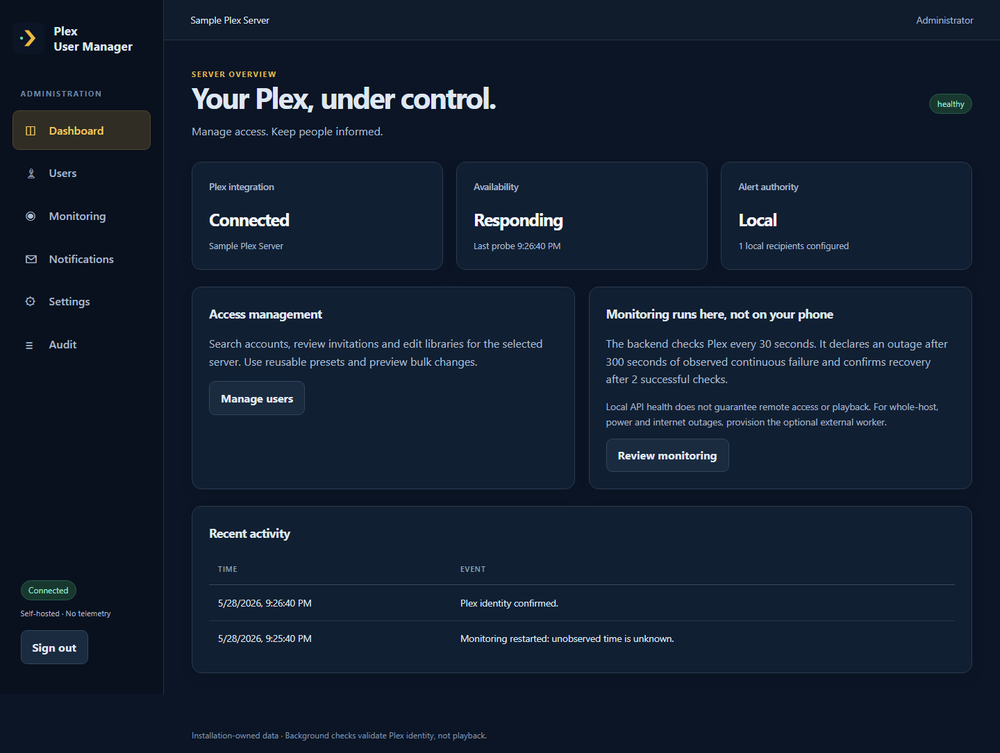
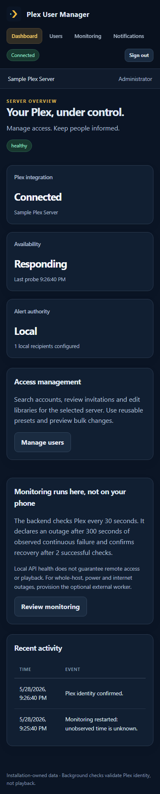

# Plex User Manager

An MIT-licensed, self-hosted administrator PWA for Plex library access and outage notifications. React + TypeScript, Node + TypeScript and SQLite run in one production container. There is no telemetry, central backend or paid service requirement.





## Features

- Bootstrap-protected administrator setup, independent Plex PIN sign-in, owned-server selection and identity verification.
- Searchable/sortable users and pending invitations, library editors, server-specific revocation, bulk preview with individual results, administrator notes and presets.
- Content-rating and allowed-label restrictions for shared accounts with Plex Pass, with explicit confirmation of account-wide scope.
- Persisted access expiries that process overdue work on startup, audit history and reconciliation with Plex before and after changes.
- Backend monitoring with configurable thresholds, recovery confirmation, maintenance windows, recipients and plain-text templates.
- Persisted incidents, observed downtime, unknown restart gaps and separate SMTP deliveries with bounded retries and visible failures.
- Optional external heartbeat worker with its own persistence, SMTP and recipients, able to alert without contacting an unavailable NAS.
- Responsive, keyboard-accessible PWA, offline mutation blocking and a service worker limited to public static files.
- Non-root Docker packaging, Compose, reverse-proxy examples, CI and an explicitly manual GHCR release workflow.

## Start here

Follow [the Synology installation walkthrough](docs/synology.md) or [generic deployment](docs/deployment.md). No image has been published by this implementation. Build `plex-user-manager:local` from this repository on a Docker-capable host, or use a versioned image after an authorised release workflow runs.

```sh
docker build --platform linux/amd64 -t plex-user-manager:local .
```

Keep runtime `.env`, secrets, SQLite databases and backups outside the source checkout. `.env.example` contains only placeholders; replace them locally. The app needs no media-directory mount, elevated privileges or Docker socket.

## Important limitations

Plex remains the source of truth. Sharing management uses Plex account-service APIs inspected in maintained integrations; those APIs do not have a public stability contract. Unexpected responses fail closed and mutations are never blindly retried. See [Plex capability research and API boundaries](docs/plex-api.md). This implementation has **mocked integration tests, not live Plex compatibility verification**. Validate a disposable share before relying on automated revocation or account restrictions.

Managed-user creation, Plex Home membership, downloads permissions, Live TV, and invite acceptance are deliberately left in Plex Web. Schedule access expiry after an invitation is accepted; pending invitation identifiers can change. Managed users are shown only when Plex exposes their selected-server share. Shared-user rating/label filters apply to account sharing settings across servers; the UI requires that scope to be acknowledged. Empty library access uses explicit server-share revocation rather than an ambiguous “share everything” request.

Local monitoring proves only that the selected Plex identity API responded with the expected machine identity. It does not prove playback, external reachability or internet connectivity. A monitor running on a NAS cannot send during that NAS’s power, host or internet outage. The [external worker](docs/external-monitor.md) detects missed authenticated heartbeats and local Plex probe failures from a separate host; it does not test the public Plex playback path.

SMTP retries can produce duplicates when acceptance is unknown. Each confirmed incident has one logical outage and one recovery entry per eligible recipient. Unsent outage messages become stale on recovery; recovery follows an accepted outage unless the recipient explicitly opted for recovery-only alerts. Maintenance suppression, preference changes and external alert authority can intentionally suppress delivery.

Linux amd64 is the prepared image target. The base supports arm64, but this repository does not publish or claim a verified arm64 build. SQLite and secrets must persist on local storage. Run exactly one application process per database.

## Development and verification

Use Node 24 LTS (Node 22.20+ is also compatible with the source; its built-in SQLite emits an experimental warning).

```sh
npm ci
npm run format
npm run check
npx playwright install chromium
npm run test:browser
npm run privacy
node scripts/docker-smoke.mjs linux/amd64
```

Run the backend with runtime `ENCRYPTION_KEY`, `BOOTSTRAP_SECRET`, `PUBLIC_URL=http://localhost:3000` and an ignored `DATA_DIR`, then `npm run dev`. Build the frontend for same-origin local testing with `npm run build`. For Vite development, set `PUBLIC_URL=http://localhost:5173` and run `npm run dev:web` alongside the backend; Vite proxies `/api` and all CSRF origins match that configured origin.

Prettier and ESLint are required by CI. Dependencies are exact and locked; `npm ci` uses the committed resolver configuration. Docker’s Node base is pinned by digest; override only with a reviewed image and update the pin during security upgrades. Browser tests intercept API routes with synthetic data and generate the screenshots above. Unit/integration tests use a mock Plex adapter and a loopback SMTP server; they never invite, revoke or email real accounts.

See [verification record](docs/verification.md), [architecture](docs/architecture.md), [backup and upgrades](docs/operations.md), [contributing](CONTRIBUTING.md) and [security reporting](SECURITY.md). This application is independent of Plex and is not an official Plex product.
